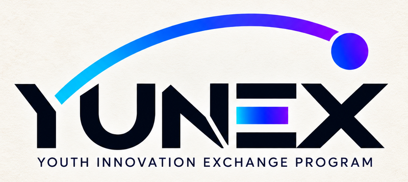

<p align="center">
  
</p>

# Yunex Demo: reliable LLM pipelines, running locally

Support material for a talk at the **Yunex hackathon** (Youth Innovation Exchange
Program), held in **Quba, Azerbaijan, from 7 to 10 November 2026**. The talk is about
**reliably using LLMs to extract data, classify it, and act on it**.

The models run on your own machine, with no API keys, and your documents stay there.
The network is only used to download the models, fetch 10-K filings from SEC EDGAR
(which sends your `SEC_USER_AGENT`), and fetch prices from Yahoo Finance.

| Piece | What it does |
|---|---|
| [Ollama](https://ollama.com) | serves `gemma4` for generation and `embeddinggemma-2` for embeddings |
| [ChromaDB](https://trychroma.com) | vector store for the filings |
| [Streamlit](https://streamlit.io) | the UI, one page per step of the talk |

## What the demo shows

Each page adds one technique, building from a bare model to a guarded agent.

| Page | What it shows | Try this |
|---|---|---|
| **Stack Health** | Every service is up, and embedding, storing and querying work together | *Run checks* |
| **Bare chatbot** | The model with only a system prompt: the baseline | Ask it something it can't know |
| **One-off** | A schema enforced by Ollama, defences against prompt injection, and a check that values appear in the document | Upload a PDF from `example_docs/one_off/`; each hides an instruction in its text layer |
| **Workflow** | A fixed path: classify, route, extract, validate, load. The model fills in steps and the code decides | *Load sample inbox* |
| **Embedding search** | Search a real 10-K by meaning, with no LLM generating anything | Needs filings indexed |
| **Agent** | The model picks the tools, code guards every call, and a human approves trades | Needs filings indexed |

## Quick start

You need [Docker](https://docs.docker.com/get-docker/) with Compose, and `make`. On
native Windows, without `make`, see [Windows](#windows).

**1. Clone the repo.**

```bash
git clone https://github.com/jpedropereira/yunex_demo.git
cd yunex_demo
```

**2. Start the stack with the command for your hardware.** All three run the same app
and differ only in where inference runs. The first run downloads about 4.6 GB of models.

| Your machine | Command | Ollama runs | One-time setup |
|---|---|---|---|
| **NVIDIA GPU**, Linux or Windows/WSL2 (preferred) | `make up-gpu` | in a container | Linux: [install the toolkit](#linux--nvidia) |
| **Apple Silicon Mac** | `make up-external` | on the host | [install Ollama and pull the models](#macos) |
| **No GPU** | `make up` | in a container | none |

Use the GPU if you have one: a workflow makes several LLM calls in a row, so slow calls
add up quickly.

**3. Check it.** Open <http://localhost:8501> and run **Stack Health**, or run
`make health` in a terminal. Without the NVIDIA toolkit, `make up-gpu` warns and falls
back to CPU, so check the *Acceleration* row, which reports what Ollama really loaded.

**4. Index the filings.** The Embedding search and Agent pages need them. The SEC asks
automated clients to say who they are, so add your name and a real address to a `.env`
file in the repo root (it is gitignored):

```bash
SEC_USER_AGENT="Your Name you@example.com"
```

Then **re-run the command from step 2**, so the app picks up the value, and index:

```bash
make index-all    # the latest 10-K of NVIDIA, Apple, Microsoft, Alphabet and Amazon
```

Re-run the same command rather than plain `make up` whenever you edit `.env`: `make up`
would move a GPU or host Ollama setup onto CPU in a container.

## Before the talk

Do this on good wifi, before you reach the venue:

1. Run your `up` command, so the models are downloaded.
2. Run `make index-all`.
3. Open the **Agent** page once. It saves a copy of the prices and lists the indexed filings.
4. Run `make warm`, so the first call on stage isn't cold, and then `make health`.

Without internet, the app still runs and the filings can still be searched. The Agent
uses the saved prices, labelled as cached. With no saved prices, research still works
but trading is disabled. Indexing a new filing does need internet.

Avoid `make clean` after this: it deletes the models, the filings, the portfolio and
the saved prices.

## Platform setup

### Linux + NVIDIA

Docker can't see the GPU until the container toolkit is installed. This is a one-time
change on the host:

```bash
curl -fsSL https://nvidia.github.io/libnvidia-container/gpgkey \
  | sudo gpg --dearmor -o /usr/share/keyrings/nvidia-container-toolkit-keyring.gpg
curl -s -L https://nvidia.github.io/libnvidia-container/stable/deb/nvidia-container-toolkit.list \
  | sed 's#deb https://#deb [signed-by=/usr/share/keyrings/nvidia-container-toolkit-keyring.gpg] https://#g' \
  | sudo tee /etc/apt/sources.list.d/nvidia-container-toolkit.list
sudo apt-get update && sudo apt-get install -y nvidia-container-toolkit
sudo nvidia-ctk runtime configure --runtime=docker
sudo systemctl restart docker
```

Check that it worked, then run `make up-gpu`:

```bash
docker run --rm --gpus all ubuntu nvidia-smi
```

### macOS

Docker on macOS has no route to the Apple Silicon GPU, so run Ollama natively:

```bash
brew install ollama
OLLAMA_HOST=0.0.0.0:11434 ollama serve   # in its own terminal
ollama pull gemma4:e2b-it-qat
ollama pull embeddinggemma-2:270m
make up-external                         # Chroma and Streamlit in Docker, Ollama on the host
```

Ollama binds to `127.0.0.1` by default, which refuses connections from containers, so
`OLLAMA_HOST=0.0.0.0:11434` is required. The same applies to a native Ollama on Windows.
The `external` profile was verified on Linux, so watch for this on Docker Desktop.

Pull models with `ollama pull` on this setup. `make pull` and `make pull-e4b` use the
containerised Ollama.

### Windows

**Use the WSL2 backend** (Docker Desktop's default). In a WSL2 shell everything works
as on Linux, and `make up-gpu` gets the GPU from the host NVIDIA driver alone.

In native PowerShell or cmd the Makefile doesn't work, so use Compose directly:

```powershell
docker compose up -d                                                 # CPU
docker compose -f compose.yaml -f compose.gpu.yaml up -d             # NVIDIA
docker compose exec -T app python -m yunex_demo.health               # same as make health
docker compose exec -T app python -m yunex_demo.sec.ingest --all     # same as make index-all
```

The NVIDIA command skips the Makefile's check, so without the toolkit you get
`could not select device driver "nvidia"` instead of a fallback to CPU.

## Hardware and models

The defaults target a **16 GB laptop**. The working set is about 6.5 GB, including
Chroma and Streamlit.

| Model | Size | Notes |
|---|---|---|
| `gemma4:e2b-it-qat` | 4.3 GB | "effective 2B", built for edge devices, native function calling |
| `embeddinggemma-2:270m` | 304 MB | 768 dimensions, 8K context |

**On an 8 GB machine**, use the 1B model by adding this to `.env`:

```bash
MODEL_MAIN=gemma3:1b-it-qat
```

**The Agent page can't use this model**: Ollama rejects its tool calls with
`does not support tools`. So it stays on `AGENT_MODEL`, which is still downloaded (4.3 GB)
and hasn't been tested on 8 GB. To skip that download and go without the Agent page, also
set `AGENT_MODEL=gemma3:1b-it-qat`.

**CPU works too**, which lets the demo run on any attendee's laptop. Schema-constrained
extraction only produces about 100–250 tokens. Measured with `make health`:

| Hardware | Throughput | ~200-token extraction |
|---|---|---|
| i7-13700K, 24 threads, CPU only | **42 tok/s** | ~5 s |
| typical 8-core laptop CPU (estimated) | ~12–15 tok/s | ~15 s |

Run `make health` for the real number on your machine. Three settings keep CPU presentable:

- `OLLAMA_KEEP_ALIVE=-1`: weights never unload during the talk.
- `make warm`: preloads the chat and embedding models.
- `OLLAMA_NUM_CTX=8192`: the model's 128K window would waste memory for no benefit here.

## Filings and the Agent page

**Filings.** Each company keeps one 10-K: a newer one replaces the older, and an older
one is refused. Indexing twice is safe, because a filing already there is skipped. The
Embedding search page offers the same five companies as buttons, and accepts a pasted
EDGAR URL from those companies only. Searching doesn't need `SEC_USER_AGENT`.

**Prices** come from Yahoo Finance when the page opens. Yahoo is unofficial, so the last
good prices are kept in the `agent_data` volume, with the portfolio. **Reset portfolio**
restores the starting portfolio.

**Searches** don't hand whole pages to the agent. A separate model call copies the
helpful sentences from each top page, and code keeps only those really on the page. Each
search takes a few seconds longer, and comparing two companies still fits the context.

**If tool calling is unreliable on E2B**, try the larger 6.1 GB model, with no code
changes: set `AGENT_MODEL=gemma4:e4b-it-qat` in `.env` and re-run your `up` command, which
downloads it. On macOS, run `ollama pull gemma4:e4b-it-qat` first.

## Configuration

Settings come from environment variables, through `src/yunex_demo/config.py`. The stack
runs with no `.env` at all, and `.env.example` lists every option.

If you copy `.env.example` to `.env`, replace the placeholder `SEC_USER_AGENT`, or it is
sent to the SEC as is.

### Ports

| Service | From your machine | Inside the network | Change the host port with |
|---|---|---|---|
| Streamlit | `http://localhost:8501` | | `APP_PUBLISHED_PORT` |
| ChromaDB | `http://localhost:8100` | `chroma:8000` | `CHROMA_PUBLISHED_PORT` |
| Ollama | `http://localhost:11434` | `ollama:11434` | `OLLAMA_PUBLISHED_PORT` |

Chroma uses 8100 on your machine because 8000 is so often taken. If a host port
collides, change its `*_PUBLISHED_PORT`. **Don't change `CHROMA_PORT`**: it is the port
the app uses inside the network, where Chroma always listens on 8000.

## Commands

`make help` prints this list too.

```
make up-gpu        Start with NVIDIA acceleration (preferred, if you have a card)
make up-external   Start against an Ollama on the host (macOS)
make up            Start on CPU (works anywhere, no host setup)
make pull          Download the models ahead of time (CPU setup; the up commands above also do this, except up-external)
make pull-e4b      Download the larger Agent model (container Ollama only)
make index-all     Index the latest 10-K of all five companies; skips those already there
make index-nvda    Index only NVIDIA's 10-K
make reindex       Rebuild the index from the SEC; keeps the old one if any filing fails
make warm          Load the models into memory before presenting
make health        Run the stack checks in the terminal; non-zero exit on failure
make logs          Follow the logs of all services
make ps            Show service status
make down          Stop, keeping models and data
make clean         Stop and delete all volumes: models, filings, portfolio and saved prices
make lint          Format and lint (needs uv)
make test          Unit tests, with no running stack needed (needs uv)
make test-live     Tests against the running stack (needs uv)
```

## Troubleshooting

| Symptom | Cause | Fix |
|---|---|---|
| Stack Health: `missing: gemma4:...` | The model isn't downloaded, or a bare `docker compose up` is still pulling it | Wait, or re-run your `up` command. On macOS use `ollama pull` |
| Agent page: `does not support tools` | The model has no tool calling, such as `gemma3:1b-it-qat` | Set `AGENT_MODEL` to a `gemma4` model, or use the other pages |
| Embedding search can't read the index, or searches fail with `'printed_page'` | The index was made by an older version | `make reindex`. Don't use `make clean`, which also deletes the models |
| Acceleration row says **CPU** after `make up-gpu` | The toolkit is missing, so it fell back to CPU | See [Linux + NVIDIA](#linux--nvidia) |
| `could not select device driver "nvidia"` | The toolkit is missing and you ran raw `docker compose` | Install it, or use `make up-gpu`, which falls back to CPU |
| `make up-external`: `Connection refused` | The host Ollama is bound to `127.0.0.1` | Start it with `OLLAMA_HOST=0.0.0.0:11434 ollama serve` |
| `Bind for 0.0.0.0:... failed: port is already allocated` | Something else owns that host port | Set the matching `*_PUBLISHED_PORT` in `.env` |
| `curl localhost:8000` to Chroma fails | Chroma is on **8100** on your machine | Use <http://localhost:8100> |
| App can't reach Chroma after editing `.env` | `CHROMA_PORT` was changed | Set it back to `8000`. See [Ports](#ports) |
| `model-init: set: Illegal option -` | CRLF line endings on `docker/*.sh` | `git config core.autocrlf false`, then check the files out again |
| `time: missing unit in duration "-1"` | `OLLAMA_KEEP_ALIVE` is a non-numeric string | Use seconds (`-1`, `300`) or a Go duration (`5m`) |
| Generation speed: "too few tokens" | The model stopped early | Run it again. Under 10 tokens gives no meaningful speed, so this isn't a stack failure |
| Works, but slowly | CPU inference | `make warm` before presenting. See [Hardware and models](#hardware-and-models) |
| Code edits don't show up | Only `./src` is mounted into the container | Rebuild by re-running your `up` command |

## Layout

```
compose.yaml                 base stack (CPU default)
compose.gpu.yaml             NVIDIA device reservation
compose.external.yaml        host Ollama instead of the container
docker/                      app image, model download, GPU check
example_docs/                sample PDFs for the One-off and Workflow pages
src/yunex_demo/
  config.py                  single source of truth for settings
  health.py                  stack checks (shared by the page and make health)
  warm.py                    model preloading
  chat.py                    Bare chatbot
  extract.py                 One-off
  workflow/                  Workflow: pipeline, schemas, validators, database
  sec/                       Embedding search: fetch, split, embed, query
  agent/                     Agent: loop, tools, guards, portfolio, prices
  ui/                        Streamlit home page and pages
tests/                       test suite
```

To change the code or run the tests, see [CONTRIBUTING.md](CONTRIBUTING.md).
